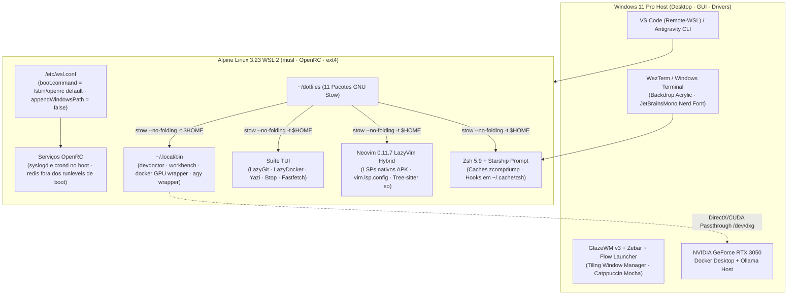

<div align="center">


&nbsp;&nbsp;&nbsp;&nbsp;&nbsp;&nbsp;&nbsp;&nbsp;


# Alpine WSL Dotfiles

### Alpine Linux 3.23 &bull; WSL 2 &bull; Windows 11 Rice

[](https://github.com/pedrohpsantos/dotfiles/actions/workflows/ci.yml)
[](https://alpinelinux.org/)
[](https://learn.microsoft.com/windows/wsl/)
[](https://neovim.io/)
[](https://github.com/catppuccin/catppuccin)
[](LICENSE)

<br/>

[Visão Geral](#1-visão-geral) &bull;
[Ambiente de Referência](#2-ambiente-de-referência) &bull;
[Instalação Rápida](#3-guia-de-instalação-rápida-quick-start) &bull;
[O que é Gerenciado](#4-o-que-é-gerenciado) &bull;
[Arquitetura](#5-arquitetura--topologia-do-subsistema) &bull;
[Stack e Funcionalidades](#6-stack-e-funcionalidades) &bull;
[Performance](#7-performance--benchmarks-do-ambiente-de-referência) &bull;
[Atalhos](#8-ergonomia--atalhos-essenciais) &bull;
[Windows 11 Rice](#9-windows-11-rice) &bull;
[Governança e Testes](#10-governança-ci--validação-de-qualidade)

</div>

---

## 1. Visão Geral

Este repositório contém a infraestrutura de configuração versionada para uma workstation de desenvolvimento baseada em **Alpine Linux 3.23 no WSL 2**, combinada com gerenciamento declarativo via **GNU Stow**, provisionamento reprodutível de pacotes APK nativos e integração com o desktop **Windows 11**.

O projeto prioriza:
- **Ferramental nativo compilado para musl libc:** Compiladores, Language Servers, formatadores e analisadores Tree-sitter instalados diretamente pelos repositórios oficiais APK do Alpine, sem intermediários de binários `glibc` como o Mason.
- **Estrutura modular e reversível:** Configurações de usuário organizadas em módulos independentes aplicados por links simbólicos (`stow --no-folding`).
- **PATH curado e interoperabilidade WSL preservada:** `appendWindowsPath = false` no `/etc/wsl.conf` para evitar a inclusão automática de dezenas de pastas do Windows que degradam o desempenho de I/O no barramento 9P, mantendo a capacidade de execução de binários Windows com wrappers e caminhos explicitamente configurados.
- **Identidade visual coerente:** Paleta **Catppuccin Mocha** unificada entre Neovim, Tmux, Starship, ferramentas TUI e o desktop Windows 11.

> [!NOTE]
> Este é um ambiente pessoal configurado para a máquina de trabalho descrita abaixo. Usuários em outras distribuições ou hardwares podem precisar adaptar caminhos nos wrappers de integração com Windows e Docker.

---

## 2. Ambiente de Referência

Hardware e versões verificadas no ambiente principal:

| Componente | Configuração de Referência |
| :--- | :--- |
| **Computador / Host** | Acer Nitro V15 (`ANV15-51`) &bull; Intel Core i5-13420H (12 vCPUs) &bull; 16 GB RAM |
| **GPU Dedicada** | NVIDIA GeForce RTX 3050 Laptop GPU (6 GB VRAM) |
| **Sistema Host** | Windows 11 Pro (`26300`) &bull; WSL `2.7.14` |
| **Distribuição Guest** | Alpine Linux `3.23.8` (x86_64) &bull; musl libc `1.2.5` &bull; OpenRC |
| **Kernel WSL** | `6.18.33.2-microsoft-standard-WSL2` |
| **Shell & Multiplexador** | Zsh `5.9` &bull; Starship `1.24.2` &bull; Tmux `3.6` |
| **Editor Principal** | Neovim `0.11.7` (LazyVim Hybrid + LSPs nativos do sistema) |
| **Gerenciador de Dotfiles**| GNU Stow `2.4.1` &bull; APK Package Manager |
| **Tema Geral** | Catppuccin Mocha (Acentos Sapphire, Teal e Lavender) |

---

## 3. Guia de Instalação Rápida (Quick Start)

### Pré-requisitos
1. WSL 2 habilitado no Windows 11 com uma distribuição Alpine Linux instalada (ex: `Alpine-3.23.4`).
2. Repositório clonado **sempre dentro do sistema de arquivos ext4 nativo do Linux** (`$HOME`), nunca dentro de montagens NTFS em `/mnt/c/`.

### 1. Clonar o repositório
```sh
git clone https://github.com/pedrohpsantos/dotfiles.git ~/dotfiles
cd ~/dotfiles
```

### 2. Simular a instalação (Dry-Run seguro)
Valida dependências, inspeciona arquivos conflitantes e simula os links do GNU Stow sem alterar o sistema:
```sh
./install.sh --dry-run
```

### 3. Executar o bootstrap automatizado
Instala pacotes APK faltantes, cria backup preventivo de eventuais arquivos reais em `$HOME`, aplica os symlinks GNU Stow, compila caches do Zsh (`zcompile`) e valida serviços OpenRC:
```sh
./install.sh
```

### Flags disponíveis no `install.sh`:
```text
Opções:
  --dry-run          Simula todas as etapas e valida conflitos GNU Stow sem alterar nada
  --with-optional    Instala pacotes opcionais de packages/alpine/optional.txt
  --skip-packages    Pula a auditoria e instalação de pacotes APK
  --skip-openrc      Pula a validação e início de serviços OpenRC
  --skip-doctor      Pula a execução da suíte devdoctor no final
  --help, -h         Exibe o manual de ajuda
```

---

## 4. O que é Gerenciado

O repositório contém **11 pacotes GNU Stow** destinados a configurações do usuário aplicadas em `$HOME`. Manifestos APK, arquivos de configuração do sistema WSL, documentação técnica e governança são mantidos em diretórios auxiliares separados:

### Pacotes GNU Stow de Usuário (`stow --no-folding -t "$HOME" <pacote>`)
| Pacote | Conteúdo Versionado | Destino em `$HOME` |
| :--- | :--- | :--- |
| **`zsh`** | `.zshenv`, `.zprofile`, `.zshrc`, `.profile`, `.config/zsh/aliases.zsh` | Configuração principal do shell e PATH curado |
| **`starship`** | `.config/starship.toml` | Prompt Catppuccin Mocha minimalista com renderização rápida |
| **`tmux`** | `.config/tmux/tmux.conf` | Prefixo `Ctrl+b`, splits preservando diretório e popups flutuantes em 92% |
| **`nvim`** | `.config/nvim/{init.lua,lazy-lock.json,lua/**}` | Neovim 0.11 com LazyVim Hybrid e Language Servers nativos musl |
| **`lazygit`** | `.config/lazygit/config.yml` | Interface TUI para Git com tema Catppuccin Mocha e Delta pager |
| **`lazydocker`**| `.config/lazydocker/config.yml` | Interface TUI para Docker Engine e Compose v2 |
| **`yazi`** | `.config/yazi/{yazi.toml,keymap.toml}` | Gerenciador de arquivos assíncrono em terminal com wrapper de *cd-on-exit* |
| **`btop`** | `.config/btop/{btop.conf,themes/catppuccin_mocha.theme}` | Monitor de recursos do sistema |
| **`fastfetch`**| `.config/fastfetch/config.jsonc` | Dashboard visual de resumo de hardware e sistema |
| **`git`** | `.gitconfig`, `.editorconfig`, `.config/git/ignore` | Configuração global do Git, credenciais GH CLI e ignore global |
| **`local-bin`**| `.local/bin/{devdoctor,workbench,wb,alpine-maint,docker,nvidia-smi,ollama,agy}` | Utilitários de diagnóstico, launchers de workspace e wrappers de interoperabilidade |

### Áreas Auxiliares do Repositório (Não aplicadas via Stow no `$HOME`)
- **`wsl-system/`:** Configuração `/etc/wsl.conf` aplicada no sistema raiz pelo `install.sh` via `doas`/`sudo`.
- **`packages/alpine/`:** Manifestos declarativos APK (`base.txt`, `tui.txt`, `dev.txt`, `security.txt`, `optional.txt`).
- **`docs/`:** Documentação técnica detalhada ([`ARCHITECTURE.md`](docs/ARCHITECTURE.md), [`INSTALLATION.md`](docs/INSTALLATION.md), [`WINDOWS_RICE.md`](docs/WINDOWS_RICE.md)).
- **`.github/`:** Pipeline de CI ([`ci.yml`](.github/workflows/ci.yml)), templates de Pull Request e Issues.

---

## 5. Arquitetura & Topologia do Subsistema



---

## 6. Stack e Funcionalidades

### Toolchains & Linguagens de Programação
- **Compiladores & Runtimes:** GCC (`build-base`), Clang 21, Go 1.25, Rust 1.91 (Cargo/Clippy), Python 3.12 (`uv`), Node.js 24 (`pnpm`), OpenJDK 21 (`maven`).
- **Language Servers (Nativos musl instalados via APK):**
  - C/C++: `clangd` (via pacote `clang21-extra-tools`)
  - Go: `gopls`
  - Rust: `rust-analyzer`
  - Lua: `lua-language-server`
  - TOML: `taplo`
- **Linters e Formatadores de Código:**
  - Python: `ruff` (executado como formatador e linter via `conform.nvim`)
  - Lua: `stylua`
  - Shell / Zsh: `shfmt` e `shellcheck`
  - C/C++: `clang-format`
  - Go / Rust: `gofmt` e `rustfmt`
- **Editor & Parsing:** Neovim 0.11 configurado sob arquitetura LazyVim Hybrid (18 plugins essenciais, `vim.lsp.config` nativo e gramáticas Tree-sitter `.so` carregadas de `/usr/lib/tree-sitter/`).

### Shell, Multiplexador & TUIs
- **Zsh 5.9:** Otimizado com autocompilação de bytecode (`zcompile`) em `~/.zshenv`, `~/.zprofile` e `~/.zshrc`.
- **Hooks cacheados:** Geração única e carregamento assíncrono para `zoxide`, `direnv` e `compinit` em `~/.cache/zsh/`.
- **Tmux 3.6:** Atalhos ergonômicos e suporte a janelas flutuantes em popups centralizados a 92% da tela para ferramentas TUI.
- **Suíte TUI:** `lazygit`, `lazydocker`, `yazi` (com wrapper `y` para cd-on-exit), `btop`, `fastfetch` e visualizador de diff `delta`.

### Interoperabilidade WSL e Aceleração GPU
- **PATH Controlado:** `appendWindowsPath = false` impede a inclusão automática dos diretórios presentes no PATH do Windows no PATH do Linux.
- **Execução Preservada:** `interop.enabled = true` mantém o registro `/proc/sys/fs/binfmt_misc/WSLInterop` ativo. Os comandos essenciais do Windows são acessados por caminhos curados ou wrappers em `~/.local/bin/`:
  - `clip.exe` (via alias `pbcopy` ou cópia no Tmux)
  - `explorer.exe` (via alias `open`)
  - `powershell.exe` (via alias `pbpaste`)
  - `code` (script bash do VS Code Remote)
  - `agy` (wrapper `~/.local/bin/agy` apontando para o executável `agy.exe` do Antigravity CLI)
- **Integração GPU no WSL 2:** O wrapper `~/.local/bin/docker` intercepta a flag `--gpus=all` no comando `docker run` e injeta automaticamente os dispositivos `/dev/dxg` e volumes `/usr/lib/wsl`, permitindo executar containers Linux `glibc` com suporte a CUDA sem necessidade de alterar o ambiente musl do Alpine.

---

## 7. Performance — Benchmarks do Ambiente de Referência

Os números abaixo representam medições reais documentadas no hardware de referência:

| Métrica | Resultado Medido | Metodologia & Condições de Teste |
| :--- | :---: | :--- |
| **Inicialização do Zsh** | **`~22 ms`** | Média aritmética obtida dividindo por 10 o tempo total medido em laço de 10 execuções interativas: `time (repeat 10 zsh -i -c exit)`. Condições: bytecode compilado (`.zwc`), cache de integração Starship (`~/.cache/zsh/starship-init.zsh`) e `appendWindowsPath = false`. |
| **Startup do Neovim 0.11** | **`~33 ms`** | Medido com `nvim --startuptime /tmp/nvim-bench.log +qa` em buffer vazio e cache de disco aquecido (warm cache). O valor final é extraído da última linha do log de inicialização (`tail -n 1`), correspondente ao tempo total decorrido até prontidão e saída. LazyVim Hybrid com 18 plugins essenciais, zero Mason e LSPs nativos `musl`. |
| **Overhead do Starship Prompt** | **`< 5 ms`** | O arquivo `~/.cache/zsh/starship-init.zsh` armazena o script de integração com o Zsh (`starship init zsh`), eliminando a execução de subprocessos no startup do shell. A latência de execução dos módulos ativos do prompt em si foi avaliada via `starship timings`, mantendo overhead inferior a 5 ms. |
| **Painel Diagnóstico devdoctor** | **`18 PASS / 0 WARN / 2 SKIP / 0 FAIL`** | Verificação estática e de integridade das ferramentas da workstation (`~/.local/bin/devdoctor`). Nota: 2 verificações marcam `SKIP` por exigirem execução funcional de containers GPU pesados (`glibc`). |

---

## 8. Ergonomia & Atalhos Essenciais

### Multiplexador Tmux 3.6 (`Prefixo: Ctrl+b`)
| Atalho | Ação |
| :--- | :--- |
| <kbd>Ctrl</kbd>+<kbd>b</kbd> <kbd>\|</kbd> | Split horizontal mantendo o diretório atual |
| <kbd>Ctrl</kbd>+<kbd>b</kbd> <kbd>-</kbd> | Split vertical mantendo o diretório atual |
| <kbd>Ctrl</kbd>+<kbd>b</kbd> <kbd>g</kbd> | Abre o **LazyGit** flutuante em popup centralizado (92%) |
| <kbd>Ctrl</kbd>+<kbd>b</kbd> <kbd>d</kbd> | Abre o **LazyDocker** flutuante em popup (92%) |
| <kbd>Ctrl</kbd>+<kbd>b</kbd> <kbd>y</kbd> | Abre o gerenciador **Yazi** flutuante em popup |
| <kbd>Ctrl</kbd>+<kbd>b</kbd> <kbd>b</kbd> | Abre o monitor **Btop** flutuante em popup |
| <kbd>Ctrl</kbd>+<kbd>b</kbd> <kbd>[</kbd> | Modo de cópia Vi (navegação com `hjkl`, seleção com `v`, cópia com `y` para `clip.exe`) |

### Neovim 0.11.7 (`Leader: Space`)
| Atalho | Modo | Função |
| :--- | :---: | :--- |
| <kbd>Space</kbd> <kbd>Space</kbd> / <kbd>Space</kbd> <kbd>f</kbd><kbd>f</kbd> | Normal | Localizar arquivos no projeto (`telescope.nvim`) |
| <kbd>Space</kbd> <kbd>/</kbd> / <kbd>Space</kbd> <kbd>f</kbd><kbd>g</kbd> | Normal | Busca textual global (`live_grep` via Ripgrep) |
| <kbd>Space</kbd> <kbd>e</kbd> | Normal | Alternar explorador em colunas Miller (`mini.files`) |
| <kbd>Space</kbd> <kbd>g</kbd><kbd>g</kbd> | Normal | LazyGit flutuante integrado ao Neovim (`Snacks.lazygit`) |
| <kbd>Space</kbd> <kbd>d</kbd><kbd>d</kbd> | Normal | LazyDocker flutuante integrado |
| <kbd>g</kbd><kbd>d</kbd> / <kbd>g</kbd><kbd>r</kbd> / <kbd>K</kbd> | Normal | Ir para Definição / Referências / Hover Documentation (`vim.lsp.config`) |
| <kbd>Space</kbd> <kbd>c</kbd><kbd>f</kbd> / <kbd>Space</kbd> <kbd>f</kbd> | Normal/Visual | Formatar buffer com `conform.nvim` (`stylua`, `ruff`, `gofmt`, `rustfmt`, `shfmt`) |
| <kbd>Space</kbd> <kbd>u</kbd><kbd>h</kbd> | Normal | Alternar Inlay Hints do LSP sob demanda |
| <kbd>Space</kbd> <kbd>x</kbd><kbd>x</kbd> | Normal | Painel de diagnósticos estruturados (`trouble.nvim` v3) |

### Utilitários do Shell
| Comando | Descrição |
| :--- | :--- |
| `wb` / `workbench [categoria]` | Seletor de workspace (`fzf` + preview `eza`) que cria sessão Tmux estruturada (`code`, `run`, `ops`) |
| `y` | Abre o Yazi com mudança de pasta ao sair: <kbd>q</kbd> muda para o diretório navegado; <kbd>Q</kbd> cancela |
| `devdoctor` | Executa o painel de diagnóstico de presença e integridade de compiladores, LSPs e ferramentas |
| `alpine-maint` | Auditoria read-only rápida de serviços OpenRC, pacotes APK e repositório Git |
| `dotfiles` | Atalho para gerenciar o repositório (`git -C ~/dotfiles`) |

---

## 9. Windows 11 Rice

O guia detalhado para configurar as ferramentas visuais do **Windows 11 Host** e manter a mesma identidade estética do terminal Alpine está disponível em:

👉 **[`docs/WINDOWS_RICE.md`](docs/WINDOWS_RICE.md)**

Configurações abordadas no documento:
- **WezTerm:** Configuração `%USERPROFILE%\.wezterm.lua` com transparência acrílica (Acrylic blur), fonte `JetBrainsMono Nerd Font` e inicialização direta no Alpine.
- **GlazeWM v3:** Tiling Window Manager em `%USERPROFILE%\.glzr\glazewm\config.yaml` com atalhos de janelas e divisão automática de tela.
- **Zebar:** Barra de status flutuante `%USERPROFILE%\.glzr\zebar\` com indicadores de uso de CPU, memória, bateria e workspaces.
- **Flow Launcher:** Tema oficial Catppuccin Mocha para pesquisa rápida de janelas e utilitários.
- **`.wslconfig`:** Parâmetros de ajuste de memória (10 GB), processadores (12 vCPUs), Sparse VHD, Memory Reclaim gradual e DNS tunneling no `%USERPROFILE%\.wslconfig`.

---

## 10. Governança, CI & Validação de Qualidade

### Automação Local com Makefile
```sh
make help      # Exibe os comandos disponíveis
make check     # Executa todos os linters e o teste dry-run do Stow
make lint      # Executa validação de sintaxe (sh -n, shellcheck, zsh -n arquivo por arquivo)
make dry-run   # Executa o ./install.sh --dry-run
make doctor    # Executa a suíte de diagnósticos devdoctor
make clean     # Remove arquivos de cache compilados (.zwc)
```

### Pipeline de CI no GitHub Actions ([`.github/workflows/ci.yml`](.github/workflows/ci.yml))
A cada Push e Pull Request contra a branch `main`, o pipeline automatizado executa:
- Validação estrita de sintaxe POSIX (`sh -n install.sh`, `sh -n zsh/.profile` e `find local-bin/.local/bin -type f -exec sh -n {} \;`).
- ShellCheck em nível `style` em todos os scripts do repositório.
- Validação sintática arquivo por arquivo do Zsh com laço explícito de `zsh -n`.
- Escaneamento preventivo de credenciais via **Gitleaks**.
- Simulação de aplicação de todos os 11 pacotes GNU Stow.

### Restauração Segura de Backups
O script `install.sh` gera automaticamente um snapshot `~/.dotfiles_backup_YYYYMMDD_HHMMSS` ao encontrar arquivos reais antes de criar os links simbólicos. O procedimento de restauração documentado em [`docs/INSTALLATION.md`](docs/INSTALLATION.md) inclui validação estrita de diretório, diff prévio seletivo restrito ao snapshot e remoção de symlinks (`stow --delete`) antes de qualquer restauração de arquivos originais.

---

## 11. Documentação Complementar & Licença

- [**Arquitetura & Decisões Técnicas:** `docs/ARCHITECTURE.md`](docs/ARCHITECTURE.md)
- [**Guia de Instalação e Rollback:** `docs/INSTALLATION.md`](docs/INSTALLATION.md)
- [**Guia de Personalização do Windows:** `docs/WINDOWS_RICE.md`](docs/WINDOWS_RICE.md)
- [**Guia de Contribuição:** `CONTRIBUTING.md`](CONTRIBUTING.md)
- [**Política de Segurança:** `SECURITY.md`](SECURITY.md)
- [**Histórico de Mudanças:** `CHANGELOG.md`](CHANGELOG.md)

Distribuído sob a licença **MIT**. Consulte [`LICENSE`](LICENSE) para mais detalhes.

<div align="center">
Desenvolvido por <b>Pedro Henrique Santos</b> &bull; 2026
</div>
