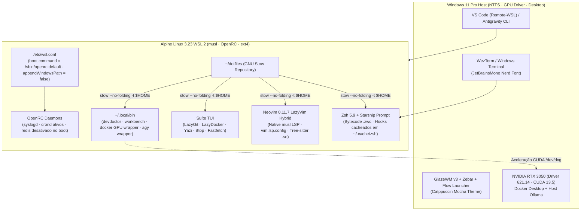

<div align="center">

#  Alpine Linux WSL 2 & Windows 11 Rice

### *Infraestrutura Pessoal de Desenvolvimento Declarativa, Modular e de Altíssima Performance*

[](https://github.com/pedrohpsantos/dotfiles/actions/workflows/ci.yml)
[](https://alpinelinux.org/)
[](https://learn.microsoft.com/windows/wsl/)
[](https://neovim.io/)
[](https://starship.rs/)
[](https://github.com/tmux/tmux)
[](https://www.gnu.org/software/stow/)
[](https://github.com/catppuccin/catppuccin)
[](LICENSE)

<br/>

[Apresentação](#-apresentação) •
[Arquitetura](#-arquitetura) •
[Módulos GNU Stow](#-módulos-gnu-stow) •
[Atalhos & TUIs](#-atalhos--suíte-tui) •
[Instalação Rápida](#-instalação-rápida) •
[Windows 11 Rice](#-windows-11-rice) •
[Governança](#-governança--qualidade)

</div>

---

## ⚡ Performance em Números

<div align="center">

| Inicialização do Shell (Zsh) | Startup do Neovim 0.11 | Renderização do Prompt | Dependências glibc / Mason |
| :---: | :---: | :---: | :---: |
| **`~22 ms`** <br/> *(Bytecode `.zwc` + Hooks cacheados)* | **`~33 ms`** <br/> *(18 plugins + Native `musl` LSP)* | **`< 5 ms`** <br/> *(Starship nativo compilado)* | **`0`** <br/> *(100% Alpine musl libc pura)* |

</div>

---

## 💎 Apresentação

Este repositório versiona e automatiza a infraestrutura de engenharia do desenvolvedor, integrando o **Alpine Linux 3.23 (WSL 2)** no backend com o visual minimalista do **Windows 11 (Catppuccin Mocha)** no host:

- 🚀 **Performance Nativa `musl`:** Zero binários `glibc` ou gambiarras de Mason. Todos os compiladores, Language Servers (`clangd`, `gopls`, `rust-analyzer`, `ruff`, `lua-language-server`, `taplo`), formatadores (`stylua`, `shfmt`) e gramáticas Tree-sitter são pacotes nativos do Alpine Linux (`/usr/lib/tree-sitter`).
- 📦 **Modularidade GNU Stow:** Cada software isolado em seu próprio módulo (`zsh`, `starship`, `tmux`, `nvim`, `lazygit`, `lazydocker`, `yazi`, `btop`, `fastfetch`, `git`, `local-bin`), aplicado de forma atômica com `--no-folding`.
- 🛡️ **Governança & Idempotência:** Bootstrap automatizado [`install.sh`](install.sh) em POSIX `sh` com suporte real a `--dry-run`, backups defensivos, pipelines de CI no GitHub Actions e suíte de auditoria de saúde [`devdoctor`](local-bin/.local/bin/devdoctor).
- 🔗 **Interoperabilidade WSL 2 Eficiente:** `appendWindowsPath = false` para eliminar lentidão de I/O de disco no barramento 9P, allowlist estrita de executáveis Windows (`clip.exe`, `explorer.exe`, `powershell.exe`, `code`, `agy`) e hooks transparentes de aceleração GPU NVIDIA CUDA (`/dev/dxg` + `/usr/lib/wsl`).
- 🎨 **Identidade Visual Consistente:** Paleta **Catppuccin Mocha** com acentos Sapphire (`#74c7ec`), Teal (`#94e2d5`) e Lavender (`#b4befe`) em todo o terminal, TUIs e no desktop Windows 11 (GlazeWM v3 + Zebar + WezTerm + Flow Launcher).

---

## 🏛 Arquitetura do Sistema



---

## 📁 Módulos GNU Stow

A estrutura do repositório é organizada em pacotes independentes cuja hierarquia interna espelha diretamente o `$HOME` (`/home/pedrohpsantos`):

```text
dotfiles/
├── .github/                          # Governança: CI Workflow, Issue Templates e PR Template
│   ├── workflows/ci.yml              # Pipeline de testes automatizados (ShellCheck, sh -n, Gitleaks, Stow)
│   ├── PULL_REQUEST_TEMPLATE.md      # Checklist e modelo padronizado de Pull Requests
│   └── ISSUE_TEMPLATE/               # Formulários estruturados para Bug Report e Feature Requests
│
├── packages/alpine/                  # Manifestos declarativos de pacotes APK (v3.23)
│   ├── base.txt                      # Shell, editor, multiplexador, git, stow, doas, ca-certificates
│   ├── tui.txt                       # lazygit, lazydocker, yazi, btop, fastfetch, fzf, fd, rg, eza, bat, delta
│   ├── dev.txt                       # clang21, gopls, rust-analyzer, ruff, lua-ls, stylua, shfmt, taplo
│   ├── security.txt                  # actionlint, osv-scanner, shellcheck, gnupg
│   └── optional.txt                  # opentofu, ansible, helm, iverilog, verilator, typst, gcc-arm-none-eabi
│
├── zsh/                              # ~/.zshenv, ~/.zprofile, ~/.zshrc, ~/.config/zsh/aliases.zsh
├── starship/                         # ~/.config/starship.toml (Prompt cápsula Catppuccin Mocha)
├── tmux/                             # ~/.config/tmux/tmux.conf (Splits, prefixo Ctrl+b, popups flutuantes em 92%)
├── nvim/                             # ~/.config/nvim/{init.lua,lazy-lock.json,lua/{config,plugins}/*.lua}
├── lazygit/                          # ~/.config/lazygit/config.yml (Delta pager + Catppuccin Mocha)
├── lazydocker/                       # ~/.config/lazydocker/config.yml (Compose v2 + visualização bat)
├── yazi/                             # ~/.config/yazi/{yazi.toml,keymap.toml} (Navegação TUI com cd-on-exit)
├── btop/                             # ~/.config/btop/{btop.conf,themes/catppuccin_mocha.theme}
├── fastfetch/                        # ~/.config/fastfetch/config.jsonc (Dashboard do sistema)
├── git/                              # ~/.gitconfig, ~/.editorconfig, ~/.config/git/ignore
├── local-bin/                        # ~/.local/bin/{devdoctor,workbench,wb,alpine-maint,docker,nvidia-smi,ollama,agy}
│
├── wsl-system/
│   └── wsl.conf                      # Configuração de sistema (/etc/wsl.conf: OpenRC boot + interop seguro)
│
├── docs/                             # Documentação técnica aprofundada
│   ├── ARCHITECTURE.md               # Decisões arquiteturais, musl, modelo em 4 camadas e OpenRC
│   ├── INSTALLATION.md               # Guia passo a passo de bootstrap, flags e rollback defensivo
│   └── WINDOWS_RICE.md               # Guia completo Windows 11 Rice (WezTerm, GlazeWM v3, Zebar, Flow Launcher)
│
├── install.sh                        # Script de bootstrap POSIX idempotente (--dry-run testado)
├── Makefile                          # Automação local: make check, make lint, make test, make doctor
├── CONTRIBUTING.md                   # Normas para adição de pacotes e padrões de código
├── SECURITY.md                       # Diretrizes de segurança e escaneamento de vulnerabilidades
├── CHANGELOG.md                      # Histórico de versões (Padrão Keep a Changelog)
└── LICENSE                           # Licença MIT
```

---

## ⌨️ Atalhos & Suíte TUI

### 1. Multiplexador Tmux 3.6 (`Prefixo: Ctrl+b`)

| Atalho | Ação | Descrição |
| :--- | :--- | :--- |
| <kbd>Ctrl</kbd>+<kbd>b</kbd> <kbd>\|</kbd> | Split Horizontal | Divide o painel horizontalmente preservando o diretório de trabalho atual |
| <kbd>Ctrl</kbd>+<kbd>b</kbd> <kbd>-</kbd> | Split Vertical | Divide o painel verticalmente preservando o diretório de trabalho atual |
| <kbd>Ctrl</kbd>+<kbd>b</kbd> <kbd>g</kbd> | Popup LazyGit | Abre o **LazyGit** flutuante em janela centralizada a 92% da tela |
| <kbd>Ctrl</kbd>+<kbd>b</kbd> <kbd>d</kbd> | Popup LazyDocker | Abre o **LazyDocker** flutuante em popup de 92% |
| <kbd>Ctrl</kbd>+<kbd>b</kbd> <kbd>y</kbd> | Popup Yazi | Abre o gerenciador de arquivos **Yazi** em popup flutuante |
| <kbd>Ctrl</kbd>+<kbd>b</kbd> <kbd>b</kbd> | Popup Btop | Abre o monitor de recursos **Btop** em popup flutuante |
| <kbd>Ctrl</kbd>+<kbd>b</kbd> <kbd>[</kbd> | Copy Mode Vi | Navegação e cópia com teclas Vi; integração com `clip.exe` no <kbd>y</kbd> |

### 2. Neovim 0.11.7 LazyVim Hybrid (`Leader: Space`)

| Atalho | Modo | Função |
| :--- | :---: | :--- |
| <kbd>Space</kbd> <kbd>Space</kbd> / <kbd>Space</kbd> <kbd>f</kbd><kbd>f</kbd> | Normal | Localizar arquivos no projeto (`telescope.nvim`) |
| <kbd>Space</kbd> <kbd>/</kbd> / <kbd>Space</kbd> <kbd>f</kbd><kbd>g</kbd> | Normal | Busca textual global em tempo real (`live_grep` com Ripgrep) |
| <kbd>Space</kbd> <kbd>e</kbd> | Normal | Alternar explorador em colunas Miller (`mini.files`) |
| <kbd>Space</kbd> <kbd>g</kbd><kbd>g</kbd> | Normal | Abrir **LazyGit** flutuante sobre o arquivo atual (`Snacks.lazygit`) |
| <kbd>Space</kbd> <kbd>d</kbd><kbd>d</kbd> | Normal | Abrir **LazyDocker** flutuante no Neovim |
| <kbd>g</kbd><kbd>d</kbd> / <kbd>g</kbd><kbd>r</kbd> / <kbd>K</kbd> | Normal | Go to Definition / References / Hover Documentation (`vim.lsp.config`) |
| <kbd>Space</kbd> <kbd>c</kbd><kbd>f</kbd> / <kbd>Space</kbd> <kbd>f</kbd> | Normal/Visual | Formatar buffer com `conform.nvim` (`stylua`, `ruff`, `gofmt`, `rustfmt`, `shfmt`) |
| <kbd>Space</kbd> <kbd>u</kbd><kbd>h</kbd> | Normal | Alternar Inlay Hints do LSP sob demanda |
| <kbd>Space</kbd> <kbd>x</kbd><kbd>x</kbd> | Normal | Painel de diagnósticos e erros do workspace (`trouble.nvim` v3) |

### 3. Utilitários do Shell (Zsh)

| Comando | Descrição |
| :--- | :--- |
| `wb` / `workbench [categoria]` | Seletor de workspace interativo (`fzf` + preview `eza`) que inicia sessão Tmux de 3 janelas (`code`, `run`, `ops`) |
| `y` | Inicia o **Yazi** com *cd-on-exit*: ao sair com <kbd>q</kbd>, o shell entra na pasta selecionada; com <kbd>Q</kbd>, permanece no diretório anterior |
| `devdoctor` | Executa o dashboard de diagnóstico com 19 verificações de integridade do ambiente |
| `alpine-maint` | Auditoria rápida read-only de pacotes APK, processos OpenRC, portas, caches e integridade Git |
| `dotfiles` | Atalho para gerenciar o repositório (`git -C ~/dotfiles`) |

---

## 🚀 Instalação Rápida

> [!IMPORTANT]
> Clone o repositório sempre no sistema de arquivos nativo Linux (`$HOME`), nunca dentro de `/mnt/c/`.

```sh
# 1. Clonar o repositório
git clone https://github.com/pedrohpsantos/dotfiles.git ~/dotfiles
cd ~/dotfiles

# 2. Simular a instalação (Dry-Run seguro sem alterações)
./install.sh --dry-run

# 3. Executar o bootstrap automatizado
./install.sh
```

### Flags Suportadas pelo Bootstrap:

```text
Opções:
  --dry-run          Simula todas as etapas e valida conflitos GNU Stow sem alterar nada
  --with-optional    Instala pacotes opcionais de packages/alpine/optional.txt
  --skip-packages    Pula a auditoria e instalação de pacotes APK
  --skip-openrc      Pula a validação e início de serviços OpenRC
  --skip-doctor      Pula a execução da suíte devdoctor no final
  --help, -h         Exibe o manual de ajuda
```

---

## 🪟 Windows 11 Rice

O guia completo para transformar o visual do seu **Windows 11 Host** e unificar a identidade visual com o Alpine Linux está documentado em:

👉 **[`docs/WINDOWS_RICE.md`](docs/WINDOWS_RICE.md)**

Ele inclui configurações prontas para copiar e colar:
- 💻 **WezTerm:** Configuração `%USERPROFILE%\.wezterm.lua` com Acrylic blur, fontes Nerd Font e abertura instantânea no Alpine.
- 🪟 **GlazeWM v3:** Tiling Window Manager em `%USERPROFILE%\.glzr\glazewm\config.yaml` com atalhos de janelas i3/bspwm e gaps elegantes.
- 📊 **Zebar:** Barra de status flutuante `%USERPROFILE%\.glzr\zebar\` com workspaces, uso de CPU, RAM, bateria e relógio.
- 🔍 **Flow Launcher:** Tema oficial Catppuccin Mocha para busca rápida e produtividade.
- ⚙️ **`.wslconfig`:** Tunings de memória (10 GB), processadores (12 vCPUs), Sparse VHD, Memory Reclaim gradual e DNS tunneling.

---

## 🛡 Governança & Qualidade

Este repositório adota práticas avançadas de engenharia de software e automação:

```sh
make help      # Exibe os comandos de qualidade disponíveis
make check     # Executa todos os linters e o teste dry-run do Stow
make lint      # Executa sh -n, shellcheck e zsh -n
make dry-run   # Simula o bootstrap completo
make doctor    # Executa a suíte de diagnósticos devdoctor
```

- **CI Automatizado:** Pipeline GitHub Actions testa sintaxe POSIX, ShellCheck, Zsh, formatação e Gitleaks em cada Push e Pull Request.
- **Prevenção de Segredos:** Escaneamento ativo com Gitleaks e regras rígidas no [`.gitignore`](.gitignore).
- **Restauração Defensiva:** Procedimento documentado em [`docs/INSTALLATION.md`](docs/INSTALLATION.md) com validação de caminho, diff seletivo restrito ao snapshot e remoção prévia de symlinks do Stow antes da cópia.

---

## 📄 Licença

Distribuído sob a licença **MIT**. Consulte [`LICENSE`](LICENSE) para mais detalhes.

<div align="center">
Desenvolvido por <b>Pedro Henrique Santos</b> • 2026
</div>
