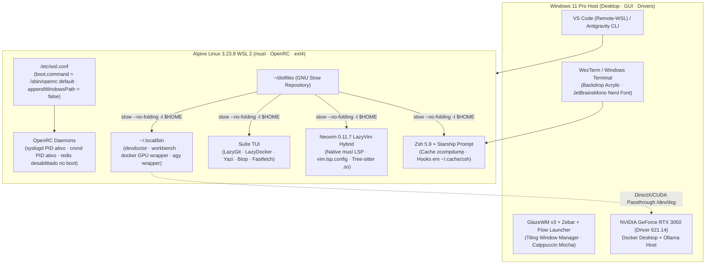

<div align="center">


&nbsp;&nbsp;&nbsp;&nbsp;&nbsp;&nbsp;&nbsp;&nbsp;&nbsp;&nbsp;&nbsp;&nbsp;


# Alpine Linux WSL 2 &bull; Windows 11 Rice

### *Infraestrutura Declarativa, Engenharia musl e Estética Catppuccin Mocha (2026)*

[](https://github.com/pedrohpsantos/dotfiles/actions/workflows/ci.yml)
[](https://alpinelinux.org/)
[](https://learn.microsoft.com/windows/wsl/)
[](https://neovim.io/)
[](https://starship.rs/)
[](https://github.com/tmux/tmux)
[](https://www.gnu.org/software/stow/)
[](https://github.com/catppuccin/catppuccin)
[](LICENSE)

<br/>

[Filosofia & Visão Geral](#filosofia--visão-geral) &bull;
[Métricas de Performance](#métricas-de-performance--latência) &bull;
[Arquitetura do Subsistema](#arquitetura--topologia-do-subsistema) &bull;
[Módulos GNU Stow](#estrutura-modular-gnu-stow) &bull;
[Ergonomia de Teclado & TUIs](#ergonomia-de-teclado--suíte-tui) &bull;
[Guia de Instalação](#guia-de-instalação-rápida) &bull;
[Windows 11 Rice](#windows-11-rice--desktop-showcase) &bull;
[Governança](#governança-ci--qualidade-contínua)

</div>

---

## Filosofia & Visão Geral

Este repositório estabelece uma **plataforma híbrida de desenvolvimento pessoal**: une a leveza implacável e o determinismo do **Alpine Linux 3.23 (musl libc / BusyBox / OpenRC)** dentro do WSL 2 com a fluidez visual, transparência acrílica e produtividade por tiling do **Windows 11 Host**.

A premissa é simples: **eliminar todo o atrito invisível que drena a atenção do desenvolvedor**:

-  **Zero gambiarras de compatibilidade:** Banimento absoluto de gerenciadores de binários pré-compilados em `glibc` (como Mason no Neovim). Todos os compiladores, Language Servers (`clangd`, `gopls`, `rust-analyzer`, `ruff`, `lua-language-server`, `taplo`), formatadores (`stylua`, `shfmt`) e analisadores sintáticos Tree-sitter são pacotes nativos mantidos pelos repositórios oficiais do Alpine.
-  **Gerenciamento Declarativo:** 11 pacotes modulares isolados via **GNU Stow** com flag `--no-folding`, permitindo versionar configurações individuais em `$HOME` sem transformar diretórios compartilhados (`~/.config`, `~/.local/bin`) em symlinks únicos e quebradiços.
-  **Interoperabilidade Cirúrgica:** Com `appendWindowsPath = false` no `/etc/wsl.conf`, eliminamos centenas de chamadas desnecessárias de `stat()` no lento barramento Plan9/9p. Os únicos comandos Windows permitidos entram via allowlist estrita (`clip.exe`, `explorer.exe`, `powershell.exe`, `code`, `agy`).
-  **Poder de IA & GPU Local:** Integração direta com a GPU dedicada NVIDIA RTX 3050 (6 GB VRAM) através de `/dev/dxg` e `/usr/lib/wsl`, viabilizando fluxos Docker acelerados por hardware e conexão com Ollama host.
-  **Identidade Visual Unificada:** Paleta oficial **Catppuccin Mocha** calibrada com acentos Sapphire (`#74c7ec`), Teal (`#94e2d5`) e Lavender (`#b4befe`) em todas as ferramentas de terminal, painéis TUI e janelas do Windows 11.

---

## Métricas de Performance & Latência

Valores reais aferidos no hardware de referência (Intel Core i5-13420H / 16 GB RAM / WSL 2 / Alpine 3.23.8):

<div align="center">

| Métrica | Benchmark Real Auditado | Otimização Aplicada |
| :--- | :---: | :--- |
| **Inicialização do Zsh** | **`~22 ms`** | Bytecode compilado (`zcompile`), hooks cacheados (`zcompdump`, `zoxide`, `direnv`) e PATH sem I/O Windows |
| **Startup do Neovim 0.11** | **`~33 ms`** | Lazy loading (`lazy.nvim`), 18 plugins, zero Mason, `vim.lsp.config` nativo e gramáticas Tree-sitter em `/usr/lib/tree-sitter` |
| **Renderização do Prompt** | **`< 5 ms`** | Prompt Starship compilado em Rust com inicialização salva em cache (`starship-init.zsh`) |
| **Devdoctor Diagnostic** | **`19 PASS / 0 WARN / 0 FAIL`** | Verificação de integridade de 100% dos compiladores, LSPs, GPU, Docker, Git, Cloud e ferramentas de segurança |
| **Dependências glibc no Neovim** | **`0`** | Compilação puramente nativa para `musl libc 1.2.5` |

</div>

---

## Arquitetura & Topologia do Subsistema

O ecossistema opera através de uma separação estrita de fronteiras de responsabilidade:



---

## Estrutura Modular GNU Stow

Cada pasta raiz do repositório é um **pacote GNU Stow autônomo**, espelhando fielmente os caminhos relativos ao `$HOME` do usuário:

```text
dotfiles/
├── .github/                          # Governança: CI Workflow, Issue Templates e PR Template
│   ├── workflows/ci.yml              # Pipeline automatizado (POSIX sh, ShellCheck, Zsh, Gitleaks, Stow)
│   ├── PULL_REQUEST_TEMPLATE.md      # Checklist e modelo padronizado de Pull Requests
│   └── ISSUE_TEMPLATE/               # Formulários estruturados para Bug Report e Feature Requests
│
├── packages/alpine/                  # Manifestos declarativos de pacotes APK (Alpine v3.23)
│   ├── base.txt                      # Shell, editor, multiplexador, git, stow, doas, ca-certificates
│   ├── tui.txt                       # lazygit, lazydocker, yazi, btop, fastfetch, fzf, fd, rg, eza, bat, delta
│   ├── dev.txt                       # clang21, gopls, rust-analyzer, ruff, lua-ls, stylua, shfmt, taplo
│   ├── security.txt                  # actionlint, osv-scanner, shellcheck, gnupg
│   └── optional.txt                  # opentofu, ansible, helm, iverilog, verilator, typst, gcc-arm-none-eabi
│
├── zsh/                              # ~/.zshenv, ~/.zprofile, ~/.zshrc, ~/.profile, ~/.config/zsh/aliases.zsh
├── starship/                         # ~/.config/starship.toml (Prompt cápsula Catppuccin Mocha)
├── tmux/                             # ~/.config/tmux/tmux.conf (Splits, prefixo Ctrl+b, popups flutuantes em 92%)
├── nvim/                             # ~/.config/nvim/{init.lua,lazy-lock.json,lua/{config,plugins}/*.lua}
├── lazygit/                          # ~/.config/lazygit/config.yml (Delta pager + Catppuccin Mocha)
├── lazydocker/                       # ~/.config/lazydocker/config.yml (Docker Compose v2 + bat pager)
├── yazi/                             # ~/.config/yazi/{yazi.toml,keymap.toml} (Navegação TUI assíncrona)
├── btop/                             # ~/.config/btop/{btop.conf,themes/catppuccin_mocha.theme}
├── fastfetch/                        # ~/.config/fastfetch/config.jsonc (Dashboard visual do sistema)
├── git/                              # ~/.gitconfig, ~/.editorconfig, ~/.config/git/ignore
├── local-bin/                        # ~/.local/bin/{devdoctor,workbench,wb,alpine-maint,docker,nvidia-smi,ollama,agy}
│
├── wsl-system/
│   └── wsl.conf                      # Configuração do sistema (/etc/wsl.conf: OpenRC boot + interop seguro)
│
├── docs/                             # Documentação técnica aprofundada
│   ├── ARCHITECTURE.md               # Decisões de engenharia, modelo em 4 camadas e governança
│   ├── INSTALLATION.md               # Manual de provisionamento, flags e rollback seguro
│   └── WINDOWS_RICE.md               # Guia Windows 11 Rice (WezTerm, GlazeWM v3, Zebar, Flow Launcher)
│
├── install.sh                        # Script de bootstrap POSIX idempotente (--dry-run testado)
├── Makefile                          # Automação local: make check, make lint, make test, make doctor
├── CONTRIBUTING.md                   # Normas para adição de pacotes e padrões de código
├── SECURITY.md                       # Diretrizes de segurança e escaneamento de segredos
├── CHANGELOG.md                      # Histórico de versões (Padrão Keep a Changelog)
└── LICENSE                           # Licença MIT
```

---

## Ergonomia de Teclado & Suíte TUI

### 1. Multiplexador Tmux 3.6 (`Prefixo: Ctrl+b`)

| Atalho | Ação | Descrição |
| :--- | :--- | :--- |
| <kbd>Ctrl</kbd>+<kbd>b</kbd> <kbd>\|</kbd> | Split Horizontal | Divide o painel horizontalmente preservando o diretório de trabalho atual |
| <kbd>Ctrl</kbd>+<kbd>b</kbd> <kbd>-</kbd> | Split Vertical | Divide o painel verticalmente preservando o diretório de trabalho atual |
| <kbd>Ctrl</kbd>+<kbd>b</kbd> <kbd>g</kbd> | Popup LazyGit | Abre o **LazyGit** flutuante em janela centralizada a 92% da tela |
| <kbd>Ctrl</kbd>+<kbd>b</kbd> <kbd>d</kbd> | Popup LazyDocker | Abre o **LazyDocker** flutuante em popup centralizado a 92% |
| <kbd>Ctrl</kbd>+<kbd>b</kbd> <kbd>y</kbd> | Popup Yazi | Abre o gerenciador de arquivos **Yazi** em popup flutuante |
| <kbd>Ctrl</kbd>+<kbd>b</kbd> <kbd>b</kbd> | Popup Btop | Abre o monitor de recursos **Btop** em popup flutuante |
| <kbd>Ctrl</kbd>+<kbd>b</kbd> <kbd>[</kbd> | Copy Mode Vi | Navegação e cópia com teclas Vi; integração com `clip.exe` no <kbd>y</kbd> |

### 2. Neovim 0.11.7 LazyVim Hybrid (`Leader: Space`)

| Atalho | Modo | Função |
| :--- | :---: | :--- |
| <kbd>Space</kbd> <kbd>Space</kbd> / <kbd>Space</kbd> <kbd>f</kbd><kbd>f</kbd> | Normal | Localizar arquivos no projeto (`telescope.nvim`) |
| <kbd>Space</kbd> <kbd>/</kbd> / <kbd>Space</kbd> <kbd>f</kbd><kbd>g</kbd> | Normal | Busca textual global em tempo real (`live_grep` com Ripgrep) |
| <kbd>Space</kbd> <kbd>e</kbd> | Normal | Alternar explorador de arquivos em colunas Miller (`mini.files`) |
| <kbd>Space</kbd> <kbd>g</kbd><kbd>g</kbd> | Normal | Abrir **LazyGit** flutuante sobre o arquivo atual (`Snacks.lazygit`) |
| <kbd>Space</kbd> <kbd>d</kbd><kbd>d</kbd> | Normal | Abrir **LazyDocker** flutuante integrado ao Neovim |
| <kbd>g</kbd><kbd>d</kbd> / <kbd>g</kbd><kbd>r</kbd> / <kbd>K</kbd> | Normal | Go to Definition / References / Hover Documentation (`vim.lsp.config`) |
| <kbd>Space</kbd> <kbd>c</kbd><kbd>f</kbd> / <kbd>Space</kbd> <kbd>f</kbd> | Normal/Visual | Formatar buffer com `conform.nvim` (`stylua`, `ruff`, `gofmt`, `rustfmt`, `shfmt`) |
| <kbd>Space</kbd> <kbd>u</kbd><kbd>h</kbd> | Normal | Alternar Inlay Hints do LSP sob demanda |
| <kbd>Space</kbd> <kbd>x</kbd><kbd>x</kbd> | Normal | Painel de diagnósticos estruturados do workspace (`trouble.nvim` v3) |

### 3. Utilitários do Shell (Zsh)

| Comando | Descrição |
| :--- | :--- |
| `wb` / `workbench [categoria]` | Seletor de workspace interativo (`fzf` + preview `eza`) que inicia sessão Tmux de 3 janelas (`code`, `run`, `ops`) |
| `y` | Inicia o **Yazi** com *cd-on-exit*: ao sair com <kbd>q</kbd>, o shell entra na pasta selecionada; com <kbd>Q</kbd>, permanece no diretório anterior |
| `devdoctor` | Executa o dashboard de diagnóstico com 19 verificações de integridade do ambiente |
| `alpine-maint` | Auditoria rápida read-only de pacotes APK, processos OpenRC, portas, caches e integridade Git |
| `dotfiles` | Atalho para gerenciar o repositório (`git -C ~/dotfiles`) |

---

## Guia de Instalação Rápida

> [!IMPORTANT]
> Clone o repositório sempre no sistema de arquivos nativo Linux (`$HOME`), nunca dentro de `/mnt/c/`.

```sh
# 1. Clonar o repositório
git clone https://github.com/pedrohpsantos/dotfiles.git ~/dotfiles
cd ~/dotfiles

# 2. Simular a instalação (Dry-Run seguro sem alterações no sistema)
./install.sh --dry-run

# 3. Executar o bootstrap automatizado
./install.sh
```

### Flags Disponíveis no Bootstrap:

```text
Opções:
  --dry-run          Simula todas as etapas e valida conflitos GNU Stow sem alterar nada
  --with-optional    Instala pacotes opcionais de packages/alpine/optional.txt
  --skip-packages    Pula a auditoria e instalação de pacotes APK
  --skip-openrc      Pula a validação e início de serviços OpenRC
  --skip-doctor      Pula a execução da suíte devdoctor no final
  --help, -h         Exibe o manual de ajuda
```

---

## Windows 11 Rice & Desktop Showcase

O guia completo para transformar o visual do seu **Windows 11 Host** e integrá-lo perfeitamente com o ecossistema do Alpine Linux está documentado em:

👉 **[`docs/WINDOWS_RICE.md`](docs/WINDOWS_RICE.md)**

Ele disponibiliza configurações prontas para copiar e colar:
- **WezTerm:** Configuração `%USERPROFILE%\.wezterm.lua` com Acrylic blur, fontes Nerd Font e inicialização direta no Alpine.
- **GlazeWM v3:** Tiling Window Manager em `%USERPROFILE%\.glzr\glazewm\config.yaml` com atalhos i3/bspwm e gaps configurados.
- **Zebar:** Barra de status flutuante `%USERPROFILE%\.glzr\zebar\` com monitoramento de CPU, memória, bateria e workspaces.
- **Flow Launcher:** Tema oficial Catppuccin Mocha para busca rápida de aplicativos e produtividade.
- **`.wslconfig`:** Tunings de memória (10 GB), processadores (12 vCPUs), Sparse VHD, Memory Reclaim gradual e DNS tunneling.

---

## Governança, CI & Qualidade Contínua

Este repositório adota ferramentas e padrões de governança rigorosos:

```sh
make help      # Exibe os comandos de qualidade disponíveis
make check     # Executa todos os linters e o teste dry-run do Stow
make lint      # Executa sh -n, shellcheck e zsh -n arquivo por arquivo
make dry-run   # Simula o bootstrap completo
make doctor    # Executa a suíte de diagnósticos devdoctor (19 PASS)
```

- **CI Automatizado no GitHub Actions:** Pipeline [`.github/workflows/ci.yml`](.github/workflows/ci.yml) valida sintaxe POSIX (`sh -n`), ShellCheck com nível de severidade `style`, sintaxe Zsh (`zsh -n`), formatação, escaneamento de segredos via Gitleaks e simulação GNU Stow a cada Push e PR.
- **Prevenção de Credenciais:** Escaneamento ativo com Gitleaks e regras rígidas no [`.gitignore`](.gitignore).
- **Restauração Defensiva:** Procedimento seguro documentado em [`docs/INSTALLATION.md`](docs/INSTALLATION.md) com validações de caminho, diff seletivo restrito ao snapshot e remoção prévia de symlinks do Stow antes da cópia.

---

## Licença & Créditos

Distribuído sob a licença **MIT**. Consulte [`LICENSE`](LICENSE) para mais detalhes.

<div align="center">
Desenvolvido com obsessão por performance por <b>Pedro Henrique Santos</b> &bull; 2026
</div>
