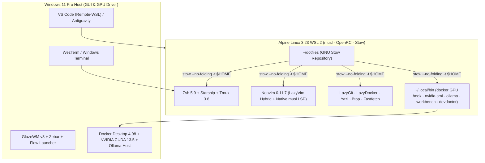

# Arquitetura do Repositório e Governança GNU Stow (`docs/ARCHITECTURE.md`)

Este documento detalha a arquitetura de diretórios, as decisões de engenharia para **Alpine Linux (`musl`) no WSL 2**, o mapeamento declarativo do **GNU Stow** e o fluxo de ciclo de vida das configurações.

---

## 1. Visão Geral da Arquitetura

O ambiente opera em um modelo híbrido estritamente separado por responsabilidade:



---

## 2. Organização dos Pacotes GNU Stow

As configurações de usuário são organizadas em **11 pacotes GNU Stow modulares** cuja estrutura interna espelha exatamente os caminhos relativos ao `$HOME` do usuário (`/home/pedrohpsantos`). Diretórios de infraestrutura, documentação e governança (`docs/`, `packages/`, `.github/`, `wsl-system/`) são áreas auxiliares do repositório, não constituem pacotes Stow e não devem ser vinculados ao `$HOME`:

| Pacote Stow | Caminho no Repositório | Destino em `$HOME` | Descrição |
| :--- | :--- | :--- | :--- |
| **`zsh`** | `zsh/.zshenv`, `.zprofile`, `.zshrc`, `.profile`, `.config/zsh/aliases.zsh` | `~/.zshenv`, `~/.zprofile`, `~/.zshrc`, `~/.profile`, `~/.config/zsh/aliases.zsh` | Shell principal (< 50 ms), PATH curado, hooks em cache e aliases |
| **`starship`** | `starship/.config/starship.toml` | `~/.config/starship.toml` | Prompt Catppuccin Mocha com cápsula ` alpine` |
| **`tmux`** | `tmux/.config/tmux/tmux.conf` | `~/.config/tmux/tmux.conf` | Multiplexador Tmux 3.6 (Prefixo `Ctrl+b`, splits `\|`/`-`, popups 92%) |
| **`nvim`** | `nvim/.config/nvim/{init.lua,lazy-lock.json,lua/**}` | `~/.config/nvim/**` | Neovim 0.11.7 LazyVim Hybrid + LSP nativo `musl` + Tree-sitter `.so` |
| **`lazygit`** | `lazygit/.config/lazygit/config.yml` | `~/.config/lazygit/config.yml` | TUI Git com Catppuccin Mocha, Delta pager e atalhos VS Code/GitHub |
| **`lazydocker`** | `lazydocker/.config/lazydocker/config.yml` | `~/.config/lazydocker/config.yml` | TUI Docker Compose v2 com shell `sh`/`bash` e inspect via `bat` |
| **`yazi`** | `yazi/.config/yazi/{yazi.toml,keymap.toml}` | `~/.config/yazi/**` | File manager TUI com bookmarks (`gp`, `gc`, `gd`, `gw`) e `cd-on-exit` |
| **`btop`** | `btop/.config/btop/{btop.conf,themes/catppuccin_mocha.theme}` | `~/.config/btop/**` | Monitor de recursos com gráficos Braille e navegação Vim |
| **`fastfetch`** | `fastfetch/.config/fastfetch/config.jsonc` | `~/.config/fastfetch/config.jsonc` | Resumo de sistema Alpine WSL 2 com acentos Sapphire/Teal |
| **`git`** | `git/{.gitconfig,.editorconfig,.config/git/ignore}` | `~/.gitconfig`, `~/.editorconfig`, `~/.config/git/ignore` | Configuração global do Git, Delta, Git LFS, GH CLI credential helper |
| **`local-bin`** | `local-bin/.local/bin/*` | `~/.local/bin/*` | Scripts e wrappers (`devdoctor`, `workbench`, `wb`, `alpine-maint`, `docker`, `nvidia-smi`, `ollama`, `rasp32-*`) |

---

## 3. Separação entre Usuário, Sistema (`/etc`) e Windows Host

### 3.1. Configurações de Usuário (`$HOME`)
Gerenciadas pelo GNU Stow com `--no-folding --target="$HOME"`. O uso de `--no-folding` impede que o Stow substitua diretórios inteiros (como `~/.config` ou `~/.local/bin`) por um único symlink de diretório, permitindo que ferramentas como `uv`, `gh` ou binários estáticos coexistam sem poluir o repositório Git.

### 3.2. Configurações de Sistema (`wsl-system/wsl.conf`)
O arquivo `wsl-system/wsl.conf` corresponde a `/etc/wsl.conf`.
- **Regra Crítica:** Nunca execute `stow -t "$HOME" wsl-system`.
- **Inicialização OpenRC:** Configurado com `[boot] command = "/sbin/openrc default"` e `systemd = false`. No boot da instância WSL 2, o init do WSL executa `/sbin/openrc default` como root, inicializando o runlevel padrão e disparando `syslog` e `crond` de forma persistente.
- **Interoperabilidade e Curadoria do PATH:** Configurado com `[interop] enabled = true` e `appendWindowsPath = false`. Isso mantém `/proc/sys/fs/binfmt_misc/WSLInterop` ativo para execução de processos Windows (.exe), enquanto `appendWindowsPath = false` impede a inclusão automática de diretórios do Windows no PATH do Linux, eliminando a lentidão de I/O no barramento 9P. O acesso conveniente aos binários Windows necessários (`clip.exe`, `explorer.exe`, `powershell.exe`, `code`, `agy`) é assegurado por caminhos explicitamente configurados em `~/.zshenv` e wrappers em `~/.local/bin/`.
- O `install.sh` compara `wsl-system/wsl.conf` com `/etc/wsl.conf` usando `cmp -s`. Somente se houver divergência, ele cria um backup `/etc/wsl.conf.bak.<timestamp>` e aplica o arquivo com `doas`/`sudo`.

### 3.3. Configurações do Windows Host (`docs/WINDOWS_RICE.md`)
Arquivos como `%USERPROFILE%\.wslconfig`, `%USERPROFILE%\.wezterm.lua`, `%USERPROFILE%\.glzr\glazewm\config.yaml` e `%USERPROFILE%\.glzr\zebar\*` pertencem ao sistema de arquivos NTFS do Windows Host e são documentados em [`docs/WINDOWS_RICE.md`](WINDOWS_RICE.md).

---

## 4. Decisões Técnicas para Alpine Linux (`musl`)

1. **Proibição de Mason no Neovim:** O `mason.nvim` baixa binários pré-compilados para `glibc` que falham ou exigem gambiarras no Alpine. Em vez disso, `nvim/.config/nvim/lua/config/lsp.lua` utiliza a API nativa `vim.lsp.config` do Neovim 0.11 conectada aos binários `musl` do APK (`clangd`, `gopls`, `rust-analyzer`, `ruff`, `lua-language-server`, `taplo`).
2. **Tree-sitter Nativo (`/usr/lib/tree-sitter`):** As gramáticas `.so` são providas pelo pacote `tree-sitter-grammars` do Alpine e carregadas sob demanda via `vim.treesitter.start`.
3. **Curadoria de `PATH` WSL 2:** Com `appendWindowsPath = false` em `/etc/wsl.conf`, `.zshenv` e `.zprofile` definem uma lista enxuta contendo apenas os caminhos Linux essenciais e as pontes necessárias do Windows (`system32`, `WINDOWS`, `WindowsPowerShell`, `VS Code`, `agy`). Isso elimina a latência de I/O em chamadas `stat()` no barramento 9P/Plan9 sem desabilitar a interoperabilidade de execução.
4. **GPU CUDA em Containers `glibc`:** O wrapper `local-bin/.local/bin/docker` intercepta `--gpus=all` em `docker run` / `docker container run` e injeta `--device=/dev/dxg -v /usr/lib/wsl:/usr/lib/wsl:ro` com `LD_LIBRARY_PATH` configurado, permitindo treinar e rodar cargas PyTorch/CUDA em containers a partir do Alpine.
5. **Modelo de Reprodutibilidade em 4 Camadas:**
   - **Camada 1 (APK Essencial):** `packages/alpine/{base,tui,dev,security}.txt` instalados pelo `apk` nativo do Alpine (`main` + `community`).
   - **Camada 2 (APK Opcional):** `packages/alpine/optional.txt` provisionados sob demanda via `./install.sh --with-optional`.
   - **Camada 3 (Ferramentas Python via uv):** Utilitários CLI isolados via `uv tool install <pkg>` (`bandit`, `pip-audit`, `esptool`).
   - **Camada 4 (Binários Estáticos de Releases Oficiais):** `gitleaks`, `trivy`, `hadolint` em `~/.local/bin/` baixados de releases oficiais com validação de hash, sem versionar binários ELF no repositório Git.

> [!NOTE]
> O script `install.sh` audita a presença dos utilitários das Camadas 3 e 4 (`gitleaks`, `trivy`, `hadolint`, `bandit`, `pip-audit`, `esptool`) e emite avisos (`WARN`) informativos caso algum não esteja disponível no `PATH`. O bootstrap **não instala essas ferramentas externas automaticamente**, pois o provisionamento de binários estáticos ou ferramentas Python via `uv tool` é uma etapa separada de conveniência do desenvolvedor.

---

## 5. Fluxo de Bootstrap, Atualização e Política de Backups

1. **Idempotência Real:** Na primeira execução sobre arquivos regulares, `install.sh` move cada arquivo conflitante para `~/.dotfiles_backup_YYYYMMDD_HHMMSS/<caminho-relativo>`, valida a cópia com `cmp -s` e aplica os symlinks do Stow. Nas execuções seguintes, `resolve_stow_conflicts` detecta que todos os links já apontam para o repositório e **não cria diretórios de backup vazios ou redundantes**.
2. **Fluxo de Edição Contínua:** Como os arquivos em `$HOME` são symlinks diretos para `~/dotfiles/<pacote>/...`, qualquer ajuste feito em `~/.config/nvim/init.lua` ou `~/.zshrc` reflete imediatamente no `git status` de `~/dotfiles`.

---

## 6. Procedimento de Teste de Reinicialização (Host Windows)

Para validar a persistência da inicialização do OpenRC após alterar `/etc/wsl.conf`:

```powershell
# No PowerShell do Windows 11 Host:
# 1. Encerrar a instância Alpine WSL 2
wsl.exe --terminate Alpine-3.23.4

# 2. Reabrir o shell da distribuição
wsl.exe -d Alpine-3.23.4

# 3. No shell do Alpine, verificar se os daemons foram iniciados pelo boot.command:
rc-status
pgrep -a syslogd
pgrep -a crond
```
